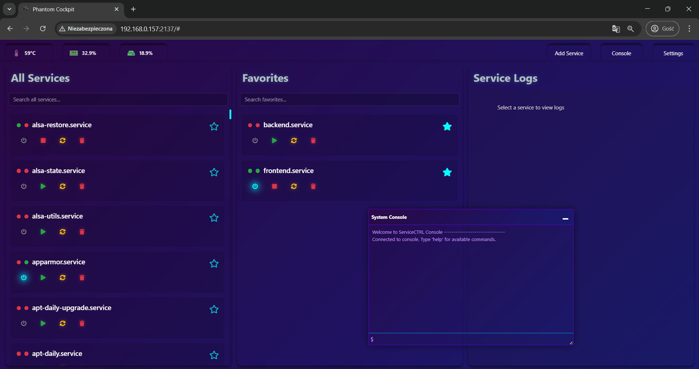
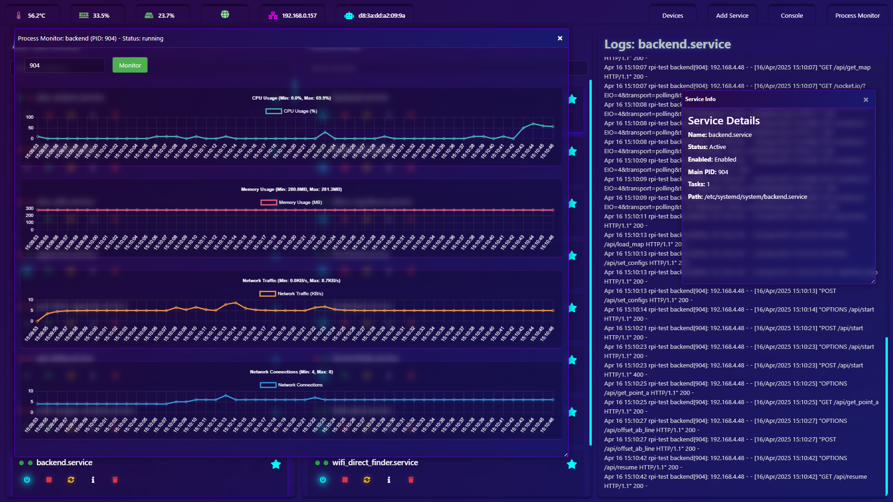

# ServiceCockpit

A web cockpit for managing a Linux device (Raspberry Pi, NVIDIA Jetson or any
systemd-based machine) from the browser: services, processes, files, consoles,
MQTT, Bluetooth and networking, with live system metrics in the header.




## Features

| Page | What it does |
| --- | --- |
| **Services** | systemd services with live status, start/stop/restart, journal, unit file editor, favorites, create new services |
| **Processes** | process list with CPU / memory / network usage, details, favorites, kill |
| **MQTT Explorer** | connect to a broker, browse topics, subscribe and publish; when no broker runs on the device, a wizard installs Mosquitto (this device only / local network / username + password) and connects to it |
| **File Explorer** | browse, edit, upload/download, cut/copy/paste, run programs with live output |
| **Bluetooth** | adapter settings, scanning and pairing, audio, file transfer (OBEX), serial port |
| **Network** | interfaces with live throughput, link speed and duplex, MTU / jumbo frames, offloads, Wi-Fi, Wi-Fi Direct, NetworkManager profiles, routes, DNS, ping; LAN scanner (devices with IP, MAC, name, vendor, open services; ping one or all; your own names per MAC address, kept when the IP changes) |
| **Tailscale** | one-click install, browser or auth-key login, connect/disconnect, this device's IPs and settings (accept routes/DNS, SSH, exit node, shields up), tailnet devices and users with online status, connection type and key expiry, ping, update check and one-click update |
| **Consoles** | multiple root or normal shells in the browser |
| **Header** | CPU temperature and usage, memory, storage, GPU, internet status and connection type (Ethernet / Wi-Fi / …), IP, MAC, device clock (click it to set the time zone / NTP), Tailscale IP and status (orange dot on its icon when a Tailscale update is available) |

## Requirements

- Linux with systemd; developed on Raspberry Pi OS (Debian 12), Python 3.11
- A user with sudo rights - logging in to the cockpit *is* entering that user's sudo password
- Optional, per feature: `bluez` (Bluetooth), `network-manager`, `ethtool`, `iw`,
  `wpasupplicant` and `dnsmasq-base` (Network / Wi-Fi Direct). Mosquitto and Tailscale
  can be installed from their pages

## Installation

```bash
git clone https://github.com/WiktorLigeza/ServiceCockpit.git
cd ServiceCockpit
./setup.sh
```

`setup.sh` creates `venv/`, installs `requirements.txt` and can optionally
install and start a `PhantomCockpit.service` systemd unit so the cockpit runs
at boot.

## Running

```bash
./run_server.sh          # or: venv/bin/python app.py
```

Then open `http://<device-ip>:2137` and log in with the device user's sudo
password.

## Security model

- The sudo password is validated with `sudo -k` and kept only in a
  server-side session (`.flask_session/`), never in a cookie.
- Every page and API requires a logged-in session.
- Network changes that could cut off the browser (MTU, forced link speed, IP
  settings on the interface you are connected through) are applied with a
  30-second automatic rollback unless confirmed.
- The cockpit has full control over the machine. Expose it only on trusted
  networks or through a VPN such as Tailscale.

## Project structure

```
app.py                     entry point: starts background workers and the server
run_server.sh / setup.sh   launcher and installer
cockpit/                   the application package
├── __init__.py            create_app(): registers every blueprint and Socket.IO handler
├── paths.py               project-root based paths (config.json, sessions, templates, static)
├── core/                  shared infrastructure
│   ├── auth.py            login, sudo session, run_sudo / require_sudo
│   ├── config_store.py    config.json settings (favorites, MQTT history, folder prefs)
│   ├── systemd.py         systemctl / journalctl wrapper
│   ├── jobs.py            background install/update tasks with a live log (shared by wizards)
│   ├── platform_info.py   Raspberry Pi / Jetson / generic detection
│   └── gpu_monitor.py     background GPU sampling
└── features/              one module or sub-package per page / API
    ├── services.py        Services page
    ├── processes.py       Processes page
    ├── mqtt.py            MQTT Explorer
    ├── mqtt_broker.py     local Mosquitto: detect, install, configure (MQTT page wizard)
    ├── file_explorer.py   File Explorer and program runner
    ├── console.py         web consoles
    ├── clock.py           header clock, time zone / NTP dialog
    ├── metrics.py         header metrics and uplink detection
    ├── updates.py         "update available" check
    ├── tailscale.py       Tailscale page: install, login, devices/users, settings, updates
    ├── export.py          source zip download
    ├── bluetooth/         controller, services (audio/files/serial), dbus_helper
    └── network/           shell, inventory, profiles, wifi, p2p, rollback, scanner, views
templates/                 Jinja2 pages (one per feature + shared header/sidebar)
static/                    css/ and js/ per feature
```

Each feature exposes `build_<name>_blueprint()` and, when it uses Socket.IO,
`register_<name>_socket_handlers(socketio)`.

### Adding a feature

1. Create `cockpit/features/<name>.py`, or a sub-package when it grows past a few hundred lines.
2. Add a template in `templates/` and assets in `static/css` and `static/js`.
3. Register the blueprint (and socket handlers) in `cockpit/__init__.py`.
4. Add a sidebar entry in `templates/sidebar.html`.

## Local files (not in git)

| Path | Purpose |
| --- | --- |
| `config.json` | per-device settings: favorites, MQTT connections, folder preferences |
| `.flask_session/` | server-side login sessions |
| `venv/` | Python virtual environment |

## TODO

- improve the console output formatting
- show CGroup under service logs
- fix tooltip background and z-level
- show and edit service files (auto restart after apply)
